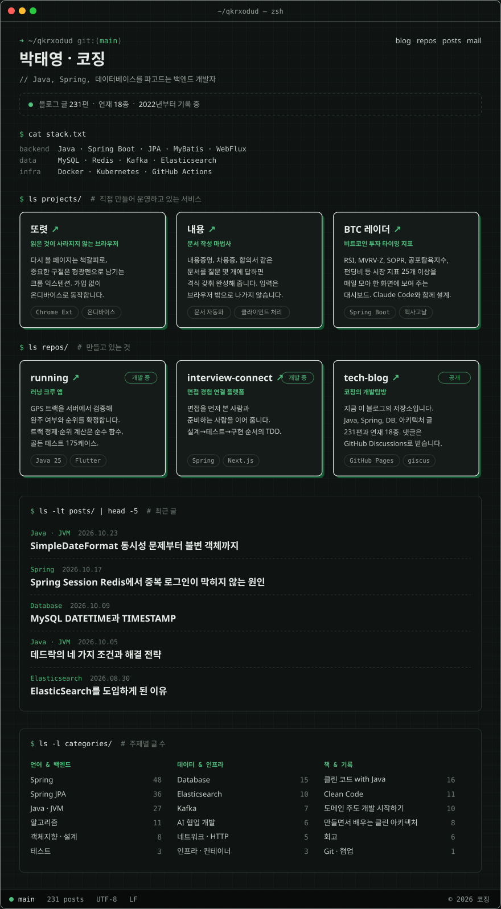

<a href="https://qkrxodud.github.io/tech-blog/"><code>blog</code></a> ·
<a href="https://qkrxodud.github.io/easy-read/"><code>또렷</code></a> ·
<a href="https://naeyong.co.kr"><code>내용</code></a> ·
<a href="https://btctiming.co.kr"><code>BTC 레이더</code></a> ·
<a href="https://github.com/qkrxodud/running"><code>running</code></a> ·
<a href="https://github.com/qkrxodud/interview-connect"><code>interview-connect</code></a> ·
<a href="mailto:qkrxodud00@gmail.com"><code>mail</code></a> ·
<a href="https://url.kr/o8rerj"><code>linkedin</code></a>

