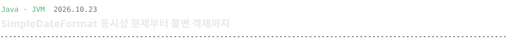
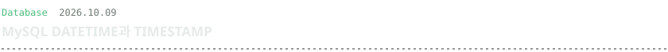
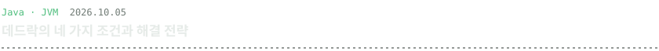
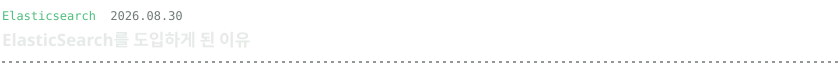

 

<code>$ ls archive/</code>

- [trading_bot](https://github.com/qkrxodud/trading_bot) — 업비트 이동평균 교차 자동매매. WebFlux, Telegram 알림
- [UserRefundCalculator](https://github.com/qkrxodud/UserRefundCalculator) — 환급금 조회 API, 외부 스크래핑 연동
- [pharmacy](https://github.com/qkrxodud/pharmacy) — 위치 기반 약국 추천. 카카오 지도 API, Redis 캐싱, Spock

 

<a href="https://qkrxodud.github.io/tech-blog/"><code>blog</code></a> ·
<a href="mailto:qkrxodud00@gmail.com"><code>mail</code></a> ·
<a href="https://url.kr/o8rerj"><code>linkedin</code></a> ·
<a href="https://qkrxodud.github.io/tech-blog/rss.xml"><code>rss</code></a>

